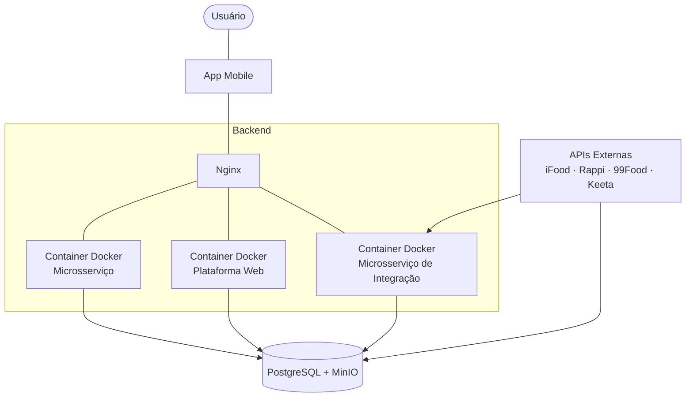

# Gerêncio

**Gerenciamento automático de estoque, pedidos e entregas para restaurantes.**

Restaurantes pequenos e médios recebem pedidos por vários canais ao mesmo tempo (iFood, Rappi, 99Food, Keeta, WhatsApp, balcão) e precisam conciliar tudo na mão. O Gerôncio centraliza esses canais em um painel único, mantém o estoque sincronizado automaticamente e organiza a operação de entrega.

> Projeto da disciplina de Engenharia de Software — UNIFESP.

---

## O problema e a solução

| Problema observado | Solução proposta |
| --- | --- |
| Múltiplas entradas de pedidos | **Painel único** — todos os canais em uma só tela |
| Atualização manual de estoque | **Atualização automática** — a baixa se propaga para todas as plataformas conectadas |
| Entregas demoradas | **Gestão de entregas e rotas** — alocação por proximidade real e frete por rota |
| Falta de visão da operação | **Controle e relatórios** — estatísticas e gráficos de vendas |
| Clientes insatisfeitos | **Clientes fidelizados** — entrega mais rápida, preço justo e acompanhamento |

### Painel único e atualização automática

Um sistema central de gerenciamento de estoque. Ao dar baixa em um item (por venda ou ajuste manual), o sistema propaga automaticamente a atualização para todas as plataformas de delivery conectadas — sem precisar abrir um app de cada vez.

### Gestão de entregas e rotas

Dois problemas concretos são atacados aqui:

1. **Alocação manual de entregadores.** Hoje a distribuição dos pedidos é feita sem lógica de proximidade real, então entregas próximas umas das outras acabam desperdiçadas — o que aumenta custo e tempo. O Gerôncio **sugere automaticamente qual entregador deve atender um novo pedido**, com base na proximidade real entre a localização atual do entregador (ou sua rota em andamento) e o novo endereço.

2. **Frete calculado em linha reta.** Plataformas como o "Anota Aí" calculam o frete pelo raio entre estabelecimento e cliente, não pela rota percorrida. Ruas, mão única e obstáculos geográficos fazem a distância real ser maior, e a diferença é absorvida pelo restaurante. A solução usa a **API do Google Maps para calcular a distância real da rota**, de forma que o frete reflita o custo real do deslocamento.

### Controle e relatórios

Estatísticas dos pedidos, análise de demanda local com aviso ao restaurante e gráficos de vendas: aplicativos que mais vendem, pratos mais pedidos e dias mais movimentados.

---

## Público-alvo

- **Principal:** pequenos e médios restaurantes com 2 ou mais entregadores próprios.
- **Secundário:** outros estabelecimentos que usam múltiplos canais de delivery (farmácias, papelarias, atacados etc.).

---

## Telas

| Tela | O que mostra |
| --- | --- |
| **Início** | Resumo da semana: avaliações de clientes e ranking de produtos mais vendidos |
| **Pedidos** | Pedidos recebidos por canal, com entregador designado, endereço, frete e total |
| **Estoque** | Quantidade disponível por produto, com ajuste manual e cadastro/remoção de itens |
| **Vendas** | Gráficos de vendas por dia da semana/mês e distribuição por produto |

---

## Stack

| Camada | Tecnologia |
| --- | --- |
| Frontend | React Native + Expo (expo-router, TypeScript) |
| Backend | Express.js |
| Banco de dados | PostgreSQL (+ MinIO para objetos) |
| Infraestrutura | Docker + Kubernetes + Nginx |
| Integrações | APIs de delivery (iFood, Rappi, 99Food, Keeta) e Google Maps |

## Arquitetura



O Nginx faz o roteamento das requisições para os microsserviços em containers Docker. O microsserviço de integração é quem conversa com as APIs das plataformas de delivery, recebendo pedidos e propagando as atualizações de estoque.

---

## Estrutura do repositório

```
.
├── frontend/        # App React Native + Expo (rotas em src/app)
├── backend/         # API Express.js
├── mock/            # Mock das plataformas de delivery (formulário web + API + banco)
├── docs/            # Pitch e documentação do projeto
└── package.json     # Workspace raiz (pnpm)
```

## Como rodar

Pré-requisitos: **Node.js** e **pnpm**.

```bash
# instalar dependências
pnpm install

# iniciar o app (Expo)
pnpm dev

# iniciar o DB (Postgres)
pnpm db

# iniciar o Backend inteiro (DB + Serviços)
pnpm backend:docker

# iniciar o Prisma Studio
pnpm studio
```

Para entrar no painel, use o usuário **admin** e a senha **admin123** (criado automaticamente quando não há nenhum usuário). Troque a senha em Perfil e cadastre a equipe em Configurações → Usuários e permissões.

O Expo abre o menu com as opções de execução: build de desenvolvimento, emulador Android, simulador iOS, Expo Go ou navegador. Dentro de `frontend/` também estão disponíveis `pnpm android`, `pnpm ios`, `pnpm web` e `pnpm lint`.

### Mock das plataformas de delivery

O `mock/` simula as plataformas de delivery (iFood, 99Food, Keeta, Uber Eats, Rappi): um formulário web monta pedidos, que são gravados em um banco próprio pela API do mock. O cardápio vem da `api-produtos` do backend, então suba o backend antes (`pnpm backend:docker`).

```bash
# sobe o banco e a API do mock (Docker) e abre o formulário web
pnpm mock

# abre o Prisma Studio do banco do mock (em outro terminal)
pnpm mock:studio
```

| Serviço | Endereço |
| --- | --- |
| Formulário web | http://localhost:3000 |
| API do mock | http://localhost:3333 |
| Banco do mock (Postgres) | `localhost:5433` |

O banco e a API continuam rodando depois de fechar o formulário; para derrubá-los, use `cd mock && pnpm db:down`.

> **Status:** frontend e backend estão em desenvolvimento. A suíte de integração exercita APIs reais com PostgreSQL isolado em Docker; a cobertura atual está documentada abaixo.

### Política de testes

Primeiro estabilizamos a base de testes do PR #46 e integramos o PR #47 de rotas. Depois ampliaremos a cobertura de todas as partes do projeto em PRs pequenos por fluxo, com cenários aprovados e resultados documentados. Durante essa sequência, os testes existentes continuam obrigatórios e as falhas conhecidas devem ser corrigidas. Leia as [regras de testes](docs/regras-de-testes.md) e o [plano de cobertura](docs/cobertura-testes.md#plano-de-ampliação-após-o-pr-47).

## Deploy (VPS)

Produção em uma VPS Ubuntu com Docker (Postgres + APIs), nginx (frontend estático + proxy das APIs) e HTTPS pelo Let's Encrypt. Tudo fica no mesmo domínio; nos exemplos, `geroncio.exemplo.com` (sem domínio próprio, use `<ip-com-hífens>.sslip.io`, que já resolve para o IP).

```
https://geroncio.exemplo.com/                  → frontend (/var/www/geroncio)
https://geroncio.exemplo.com/svc/pedidos/      → 127.0.0.1:3002
https://geroncio.exemplo.com/svc/restaurantes/ → 127.0.0.1:3003
https://geroncio.exemplo.com/svc/produtos/     → 127.0.0.1:3004
https://geroncio.exemplo.com/svc/pagamentos/   → 127.0.0.1:3006
```

### 1. Pacotes

```bash
# swap (o build do frontend precisa de memória em VPS pequenas)
fallocate -l 4G /swapfile && chmod 600 /swapfile && mkswap /swapfile && swapon /swapfile
echo '/swapfile none swap sw 0 0' >> /etc/fstab

apt update
apt install -y docker.io docker-compose-v2 nginx certbot python3-certbot-nginx nodejs npm
systemctl enable --now docker

# pnpm na versão do projeto (o corepack empacotado no Ubuntu não roda o pnpm 11)
corepack disable; rm -f /usr/bin/pnpm /usr/bin/pnpx
npm install -g pnpm@11.24.0
```

Precisa de Docker Compose ≥ 2.24 (por causa do `!override` abaixo) e Node 22.

### 2. Firewall

```bash
ufw allow OpenSSH
ufw allow 'Nginx Full'
ufw --force enable
```

O Docker publica portas por fora do `ufw`; quem fecha as portas internas é o override do passo 3.

### 3. Backend

`backend/.env` (gere as senhas com `openssl rand -hex 24`; `chmod 600 backend/.env`):

```env
POSTGRES_USER=geroncio
POSTGRES_PASSWORD=<senha>
POSTGRES_DB=geroncio
POSTGRES_PORT=5432
DATABASE_URL=postgresql://geroncio:<senha>@localhost:5432/geroncio
AUTHENTICATION_API_KEY=<chave>            # Evolution; o compose exige mesmo com o chatbot desligado
STRIPE_SECRET_KEY=sk_test_...
STRIPE_WEBHOOK_SECRET=whsec_...           # do endpoint .../svc/pagamentos/api/webhooks/stripe
PAGAMENTOS_URL_PUBLICA=https://geroncio.exemplo.com/svc/pagamentos
AUTH_SECRET=<chave longa>                 # assina os tokens de login (openssl rand -hex 32)
```

`backend/docker-compose.override.yml` (só na VPS; o compose lê sozinho) publica as portas apenas em `127.0.0.1`:

```yaml
services:
  postgres:         { ports: !override ["127.0.0.1:5432:5432"] }
  api-clientes:     { ports: !override ["127.0.0.1:3001:3001"] }
  api-pedidos:      { ports: !override ["127.0.0.1:3002:3002"] }
  api-restaurantes: { ports: !override ["127.0.0.1:3003:3003"] }
  api-produtos:     { ports: !override ["127.0.0.1:3004:3004"] }
  api-integracao:   { ports: !override ["127.0.0.1:3005:3005"] }
  api-pagamentos:   { ports: !override ["127.0.0.1:3006:3006"] }
  chatbot:          { ports: !override ["127.0.0.1:5678:5678"] }
  evolution-api:    { ports: !override ["127.0.0.1:8080:8080"] }
  llm:              { ports: !override ["127.0.0.1:11434:11434"] }
```

```bash
echo backend/docker-compose.override.yml >> .git/info/exclude
cd backend
docker compose up -d --build   # Postgres + APIs (o chatbot fica no profile "chatbot")
pnpm install
pnpm db:deploy                 # o compose não aplica as migrations
docker compose restart
curl -s localhost:3002/health
```

### 4. Frontend

`frontend/.env` (os valores entram no código no build):

```env
EXPO_PUBLIC_API_PEDIDOS_URL=https://geroncio.exemplo.com/svc/pedidos/api
EXPO_PUBLIC_API_PRODUTOS_URL=https://geroncio.exemplo.com/svc/produtos
EXPO_PUBLIC_API_RESTAURANTES_URL=https://geroncio.exemplo.com/svc/restaurantes/api
EXPO_PUBLIC_API_PAGAMENTOS_URL=https://geroncio.exemplo.com/svc/pagamentos/api
EXPO_PUBLIC_URL_RETORNO_PAGAMENTO=https://geroncio.exemplo.com/assinatura/pagamento
```

A `api-produtos` não usa o prefixo `/api`, por isso a URL dela é diferente.

```bash
cd frontend
pnpm install
NODE_OPTIONS=--max-old-space-size=3072 pnpm exec expo export --platform web   # gera dist/
mkdir -p /var/www/geroncio && rsync -a --delete dist/ /var/www/geroncio/
```

### 5. nginx e HTTPS

`/etc/nginx/proxy_geroncio.conf`:

```nginx
proxy_http_version 1.1;
proxy_set_header Host $host;
proxy_set_header X-Real-IP $remote_addr;
proxy_set_header X-Forwarded-For $proxy_add_x_forwarded_for;
proxy_set_header X-Forwarded-Proto $scheme;
# Marca o tráfego da internet: só ele exige login (o chatbot chama as APIs por dentro do Docker)
proxy_set_header X-Geroncio-Publico 1;
# Calcular rota e cotar frete consultam serviços de mapa externos (Nominatim, OSRM)
proxy_read_timeout 90s;
```

`/etc/nginx/sites-available/geroncio`:

```nginx
server {
    listen 80;
    listen [::]:80;
    server_name geroncio.exemplo.com;

    root /var/www/geroncio;
    index index.html;

    # Build "static" do Expo Router: cada tela vira um .html (ex.: /rotas -> rotas.html)
    location / {
        try_files $uri $uri.html $uri/ /index.html;
    }

    location /_expo/ {
        expires 1y;
        add_header Cache-Control "public, immutable";
    }

    # A barra no fim do proxy_pass tira o prefixo /svc/<nome>
    location /svc/pedidos/      { proxy_pass http://127.0.0.1:3002/; include /etc/nginx/proxy_geroncio.conf; }
    location /svc/restaurantes/ { proxy_pass http://127.0.0.1:3003/; include /etc/nginx/proxy_geroncio.conf; }
    location /svc/produtos/     { proxy_pass http://127.0.0.1:3004/; include /etc/nginx/proxy_geroncio.conf; }
    location /svc/pagamentos/   { proxy_pass http://127.0.0.1:3006/; include /etc/nginx/proxy_geroncio.conf; }
}
```

```bash
ln -s /etc/nginx/sites-available/geroncio /etc/nginx/sites-enabled/
rm -f /etc/nginx/sites-enabled/default
nginx -t && systemctl reload nginx
certbot --nginx -d geroncio.exemplo.com --redirect   # cria o bloco 443 e agenda a renovação
```

### 6. Depois de subir

- **Stripe:** crie o webhook em `https://geroncio.exemplo.com/svc/pagamentos/api/webhooks/stripe` (eventos `checkout.session.*`, `invoice.paid`, `invoice.payment_failed`, `customer.subscription.deleted`), coloque o `whsec_` no `backend/.env` e rode `docker compose up -d api-pagamentos`.
- **Primeiro acesso:** entre com `admin` / `admin123` e **troque a senha** em Perfil. Depois preencha Configurações → Estabelecimento (nome e endereço real, usado no frete e nas rotas) e cadastre a equipe em Usuários e permissões.
- **Chatbot:** o Ollama precisa de uns 4 a 5 GB de RAM livres. Para ligar, `pnpm chatbot` em `backend/`; o editor do n8n e o QR code da Evolution ficam só em `127.0.0.1`, então acesse por túnel: `ssh -L 8080:localhost:8080 -L 5678:localhost:5678 root@<vps>`.

### Atualizar (CI/CD)

Todo push na `develop` dispara `.github/workflows/deploy.yml`: o job **Verificar** roda os testes de integração e o typecheck do backend e o lint do frontend (o lint ainda só avisa), e o job **Publicar na VPS** entra por SSH e roda `scripts/deploy.sh`, que faz checkout da `develop`, aplica as migrations, reconstrói os containers, gera o build web, copia para `/var/www/geroncio` e testa o `/health` das APIs. Os arquivos `.env` e o override ficam como estão. Também dá para disparar pela aba Actions (*Run workflow*).

Configuração, feita uma vez:

```bash
# na sua máquina: chave só para o deploy
ssh-keygen -t ed25519 -N '' -f geroncio_deploy -C github-actions
ssh-copy-id -i geroncio_deploy.pub root@<vps>
ssh-keyscan <vps>                     # saída vai no segredo VPS_KNOWN_HOSTS
```

No GitHub, em *Settings → Secrets and variables → Actions*, crie `VPS_HOST`, `VPS_USER` (ex.: `root`), `VPS_SSH_KEY` (conteúdo de `geroncio_deploy`) e `VPS_KNOWN_HOSTS`. `VPS_PORT` (padrão 22) e `VPS_DIR` (padrão `/root/Gerencio`) são opcionais. O job usa o environment `producao`, onde dá para exigir aprovação antes de publicar.

Para atualizar à mão na VPS: `bash scripts/deploy.sh` na pasta do repositório.

---

## Equipe

- Felipe Freitas D'Elia
- Gabriel Fraga de Souza Ribeiro
- João Pedro Navarro Okita
- João Pedro Soldera Snabaitis Markues
- João Pedro Uezu da Luz
- Leonardo José de Castro Carvalho
- Lucas Gonzaga Prado
- Matheus Cahú Monteiro dos Santos

## Documentação

- [Pitch do projeto](docs/Eng.%20Software%20-%20PITCH.pdf)
- [Conceitos de testes para a equipe](docs/conceitos-de-testes.md)
- [Regras de testes e execução da suíte](docs/regras-de-testes.md)
- [Cobertura atual dos testes](docs/cobertura-testes.md)
- [Análise do PR #46 e rebase da branch lucas](docs/analise-pr-46.md)
