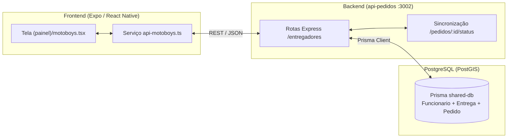

# Relatório Completo de Implementação — Dashboard e Módulo de Motoboys

**Data:** 25/10/2026  
**Projeto:** Gerôncio  
**Escopo:** Implementação Full-Stack do Dashboard de Motoboys (Banco de Dados, Backend, Sincronização de Pedidos e Frontend)

---

## 1. Contexto e História de Usuário

> **Como** dono de restaurante,  
> **quero** gerenciar e acompanhar os entregadores da minha equipe de forma centralizada e em tempo real,  
> **para que** eu saiba quem está livre, quem está em rota e como estão distribuídas as entregas do dia.

### Fluxos Atendidos:
1. **Visualização em Tempo Real**: O usuário acessa a rota `/motoboys` e visualiza os indicadores do dia (total, disponíveis, em entrega e inativos) e a lista atualizada de entregadores diretamente do banco de dados.
2. **Ciclo Operacional Sincronizado**: O status do entregador transita de forma integrada com a fila de pedidos (`disponivel` ↔ `em_entrega`).
3. **Cadastro e Gestão**: Criação de novos entregadores com validação de unicidade de CPF, edição de dados cadastrais (telefone, e-mail, placa) e alternância rápida de disponibilidade/escala.
4. **Histórico Seguro**: Proteção da integridade referencial — entregadores com histórico de entregas são inativados em vez de excluídos bruscamente.
5. **Resiliência Offline**: Caso a API fique indisponível, a tela apresenta aviso semântico e mantém a interface operável com dados locais de demonstração.

---

## 2. Arquitetura e Fluxo de Dados



---

## 3. Modificações no Banco de Dados (`packages/shared-db`)

### 3.1. Modelo `Funcionario`
No arquivo `backend/packages/shared-db/prisma/schema.prisma`, o modelo de funcionário foi estendido com a coluna de identificação veicular:

```prisma
model Funcionario {
  id       Int                  @id @default(autoincrement())
  nome     String
  cpf      String               @unique
  telefone String
  email    String
  placa    String?              // Novo campo adicionado para identificação de motoboys
  tipo     TipoFuncionario      @default(ENTREGADOR)
  status   StatusEntregador?
  vinculos VinculoFuncionario[]
  entregas Entrega[]
}
```

### 3.2. Migration Criada e Aplicada
- **Migration:** `20261025013650_adiciona_placa_funcionario`
- **Comando executado:**
  ```bash
  cd backend && pnpm db:migrate --name adiciona_placa_funcionario
  ```
- **Prisma Client:** Atualizado e compilado com os novos tipos via `@geroncio/shared-db`.

---

## 4. Endpoints Desenvolvidos no Backend (`api-pedidos`)

Todas as rotas de entregadores foram implementadas em `backend/api-pedidos/src/routes.ts`, seguindo rigorosamente as convenções de código do projeto (formato `{ error, detalhe? }`, `parseId`, validações de enum e retorno de status HTTP adequados):

| Método | Rota | Descrição | Status HTTP |
| :--- | :--- | :--- | :---: |
| `GET` | `/api/entregadores` | Lista entregadores com filtros (`?status=...`, `?busca=...`) e cálculo dinâmico de `entregasHoje`. | 200 / 400 |
| `GET` | `/api/entregadores/:id` | Busca os dados e métricas diárias de um entregador por ID. | 200 / 400 / 404 |
| `POST` | `/api/entregadores` | Cadastra novo entregador com validação de campos obrigatórios e unicidade de CPF. | 201 / 400 / 409 |
| `PUT` | `/api/entregadores/:id` | Atualiza o cadastro completo do entregador. | 200 / 400 / 404 / 409 |
| `PATCH` | `/api/entregadores/:id/status` | Altera rapidamente apenas a situação operacional (`disponivel`, `em_entrega`, `inativo`). | 200 / 400 / 404 |
| `DELETE`| `/api/entregadores/:id` | Remove o cadastro ou inativa caso possua registros na tabela `Entrega`. | 200 / 204 / 400 / 404 |

### Sincronização Automática com o Ciclo do Pedido:
1. **Atribuição de Entrega (`PATCH /api/pedidos/:id/entregador`)**:
   - Ao vincular um entregador a um pedido com status `saiu_para_entrega`, o status do entregador é automaticamente promovido para `em_entrega`.
2. **Conclusão/Cancelamento (`PATCH /api/pedidos/:id/status`)**:
   - Ao mudar o pedido para `saiu_para_entrega`, o motoboy é marcado como `em_entrega`.
   - Ao marcar como `entregue` ou `cancelado`, o sistema checa se o motoboy ainda tem outros pedidos ativos em rota; se não tiver, retorna sua situação para `disponivel`.

---

## 5. Implementação no Frontend (`frontend/`)

### 5.1. Camada de Serviço (`frontend/src/services/api-motoboys.ts`)
Criado novo serviço de comunicação com o backend em `api-pedidos`:
- `listarMotoboys(filtros?)`: Busca os dados na API com suporte a filtros de status e termo de busca.
- `buscarMotoboyPorId(id)`: Recupera dados de um motoboy.
- `criarMotoboy(dados)`: Envia cadastro com validação de payload.
- `atualizarMotoboy(id, dados)`: Submete alterações do formulário de edição.
- `atualizarStatusMotoboy(id, status)`: Atualiza a situação na API.
- `excluirMotoboy(id)`: Envia requisição de exclusão/inativação.

### 5.2. Tela do Painel (`frontend/src/app/(painel)/motoboys.tsx`)
- **Integração Assíncrona**: Substituído o estado estático inicial por `useEffect` com função `carregar()`.
- **Feedback Visual de Estado**:
  - Indicador de carregamento enquanto consome a API.
  - Alerta semântico amarelo (`cores.statusPronto`) caso haja problema de conexão com o servidor, mantendo a tela operável com dados demonstrativos em fallback.
  - Mensagem de erro de validação direto no cartão de formulário (ex.: CPF duplicado).
- **Mutações em Tempo Real**:
  - Criação e edição persistem os dados diretamente no banco via API.
  - Botão "Ativar / Desativar" executa atualização otimista na interface com reversão automática caso a requisição falhe.

---

## 6. Testes Realizados e Validação

### 6.1. Testes Automatizados de Tipagem
- **Backend:** `cd backend && pnpm typecheck`
  - Todos os 6 pacotes do workspace (`packages/shared-db`, `api-clientes`, `api-pedidos`, `api-produtos`, `api-restaurantes`, `api-integracao`) compilaram com **0 erros**.
- **Frontend:** `cd frontend && pnpm exec tsc --noEmit`
  - Compilado com sucesso, sem nenhuma pendência de tipos.

### 6.2. Testes de Integração HTTP (`testes/testes_api-pedidos.http`)
Executados testes nas rotas com respostas validadas:
- `POST /api/entregadores` (Criar entregador com sucesso): **201 Created**.
- `POST /api/entregadores` (Tentativa com CPF duplicado): **409 Conflict** (`"Já existe um funcionário cadastrado com este CPF"`).
- `GET /api/entregadores`: **200 OK** retornando lista com contagem de entregas no dia.
- `GET /api/entregadores?status=em_entrega`: **200 OK** com filtragem correta.
- `GET /api/entregadores?busca=matheus`: **200 OK** com busca case-insensitive por nome/contato/placa.
- `PUT /api/entregadores/:id`: **200 OK** atualizando nome, telefone e placa.
- `PATCH /api/entregadores/:id/status`: **200 OK** alterando status para `em_entrega` e `inativo`.
- `DELETE /api/entregadores/:id`: **204 No Content** para exclusão sem histórico e **200 OK** com inativação para entregadores com histórico.

---

## 7. Como Executar e Testar

### Subir o Backend
Na raiz do repositório:
```bash
pnpm backend
```
*(Inicia o Postgres do Docker na porta 5432 e os microsserviços Express em modo watch)*

### Subir o Frontend
Na raiz:
```bash
pnpm dev
# ou: cd frontend && pnpm web
```
Acesse o menu lateral em **Motoboys** ou navegue até a rota `/motoboys`.
